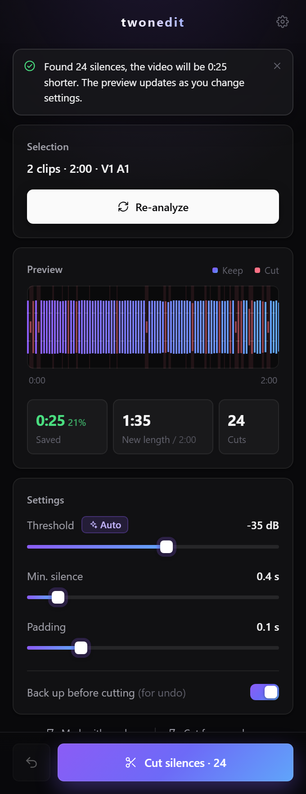

<p align="center">
  
</p>

<h1 align="center">twoncut</h1>

<p align="center">
  Adobe Premiere Pro'da sessiz yerleri doğrudan timeline'da kes.<br>
  Klipleri seç, kesimleri canlı dalga formunda gör, tek tıkla kes, beğenmezsen geri al.
</p>

<p align="center">
  <a href="https://github.com/twonxd/twoncut/releases/latest"></a>
  <a href="LICENSE"></a>
  
  
</p>

<p align="center">
  <a href="README.md">English</a> · <b>Türkçe</b>
</p>

<p align="center">
  
</p>

## Özellikler

- **Seçim üzerinde çalışır**: normal klipler, After Effects comp'ları ve iç içe sekanslar.
- **Canlı önizleme**: dalga formu neyin kalacağını ve neyin kesileceğini gösterir. Ayar değiştikçe anında güncellenir, yeniden analiz gerekmez.
- **Otomatik eşik**: eşiği kaydın kendi gürültü seviyesine göre ayarlar.
- **Yerinde kesim**: seçili izleri keser, sessiz parçaları siler ve boşlukları kapatır. Seçimden sonraki klipler de geri kayar.
- **Marker ile kontrol**: her kesime kırmızı marker koyar. Kalmasını istediklerini silersin, kalanlar kesilir.
- **Geri al**: her kesimden önce yedek sekans alınır, tek tıkla geri gelir.
- **Çok izli kayıtlar**: farklı izlerde birden fazla konuşmacı varsa, bir an ancak herkes sustuğunda sessiz sayılır.
- **İngilizce ve Türkçe**: Premiere'in dilini takip eder, ayarlardan değiştirilebilir.

## Gereksinimler

- Windows 10 veya 11
- Adobe Premiere Pro 2022 veya üstü
- [FFmpeg](https://ffmpeg.org) (kurulum programı senin için kurabilir)

## Kurulum

1. [Son sürümden](https://github.com/twonxd/twoncut/releases/latest) **`twoncut-setup.exe`** dosyasını indir.
2. Çalıştır ve **Kur**'a bas. FFmpeg yoksa önce **FFmpeg'i kur**'a bas.
3. Premiere Pro'yu yeniden başlat ve **Pencere › Uzantılar › twoncut** ile aç.

Kurulum yönetici izni istemez. Güncellemek ya da kaldırmak için aynı dosyayı tekrar çalıştırman yeterli.

> [!NOTE]
> Kurulum programı henüz dijital olarak imzalı değil, bu yüzden Windows *"Windows bilgisayarınızı korudu"* uyarısı gösterebilir. **Ek bilgi › Yine de çalıştır**'a bas. Bkz. [kod imzalama politikası](#kod-imzalama-politikası-code-signing-policy).

**Kurulum sistemde neleri değiştirir**

- Paneli `%APPDATA%\Adobe\CEP\extensions\com.twonedit.twoncut` klasörüne kopyalar.
- Adobe'nin CEP `PlayerDebugMode` ayarını açar (`HKEY_CURRENT_USER\Software\Adobe\CSXS.9` – `CSXS.13`). Premiere'in Adobe tarafından imzalanmamış panelleri yükleyebilmesi için gereklidir.
- Sadece **FFmpeg'i kur**'a basarsan: FFmpeg'i Windows Paket Yöneticisi ile kurar (`winget install Gyan.FFmpeg`).

**Kaldırma:** `twoncut-setup.exe`'yi çalıştırıp **Kaldır**'a bas. Panel klasörü silinir. Başka paneller de kullanıyor olabileceği için `PlayerDebugMode` açık bırakılır; kapatmak için yukarıdaki anahtarlardaki `PlayerDebugMode` değerini silebilirsin.

## Kullanım

1. Timeline'da temizlenecek klipleri seç (seslerinin de seçilmesi için **Linked Selection** açık olsun).
2. **Analiz et**'e bas. Dalga formunda kalacak yerler ve kırmızıyla kesilecek yerler görünür.
3. Önizleme istediğin gibi olana kadar ayarları değiştir.
4. **Sessiz yerleri kes**'e bas ya da önce kesimleri timeline'da görmek için **Marker ile işaretle**'yi kullan.
5. Sonucu beğenmedin mi? **Geri al**'a (↶) bas.

### Ayarlar

| Ayar | Ne yapar | Başlangıç için |
|---|---|---|
| **Eşik** | Bundan sessiz olan her şey sessizlik sayılır. Gürültülü kayıtta yükselt. **Oto** kayda göre ayarlar. | Oto |
| **Min. sessizlik** | Bundan kısa duraklamalar kesilmez. | 0.4–0.8 sn |
| **Pay** | Konuşmanın başına ve sonuna bırakılan nefes payı. | 0.1–0.2 sn |

## Bilinmesi gerekenler

- Sadece seçili kliplerin sesi dinlenir. Müzik ve seçilmemiş diğer izler tespiti etkilemez.
- Kesim, seçili kliplerin bulunduğu izlerde yapılır. Seçilmemiş izler (müzik, grafik) yerinde kalır. Bunları kesimden sonra ekle ya da seçime dahil et.
- Hızı değiştirilmiş klipler, comp'lar ve iç içe sekanslar gibi, sesi dışa aktarılarak analiz edilir.
- Orijinal klipler yerinde kesildiği için üzerlerindeki efektler korunur.

## Kaynak koddan derleme

Sadece Windows yeterli. .NET Framework 4.x ile gelen C# derleyicisi kullanılıyor.

```powershell
# Kurulum programını dist\twoncut-setup.exe olarak üretir
powershell -ExecutionPolicy Bypass -File installer\build.ps1

# Geliştirme sırasında paneli doğrudan repodan kurar
powershell -ExecutionPolicy Bypass -File scripts\dev-install.ps1
```

Sürüm numarası `extension/CSXS/manifest.xml` dosyasından gelir. `v*` etiketi gönderildiğinde GitHub Actions kurulum programını derler ve bir sürüme ekler.

## Kod imzalama politikası (Code signing policy)

Free code signing provided by [SignPath.io](https://about.signpath.io), certificate by [SignPath Foundation](https://signpath.org) *(başvuru değerlendirmede; onaylanana kadar sürümler imzasızdır)*.

- Kurulum programları bu repodaki etiketli commit'ten [GitHub Actions](.github/workflows/build.yml) ile derlenir; kişisel bir bilgisayarda derlenmez veya imzalanmaz.
- Her imzalama isteği bir onaylayıcı tarafından elle onaylanır.

**Ekip rolleri**

- Commit atanlar ve inceleyenler: [@twonxd](https://github.com/twonxd)
- Onaylayanlar: [@twonxd](https://github.com/twonxd)

**Gizlilik politikası**

Bu program, kullanıcı ya da onu kuran veya çalıştıran kişi özellikle istemedikçe başka ağ sistemlerine hiçbir bilgi göndermez. Tek ağ erişimi, kurulum programındaki isteğe bağlı **FFmpeg'i kur** butonudur; bu buton FFmpeg'i yayıncısından indirmek için Windows Paket Yöneticisi'ni (winget) çalıştırır ve bu indirme için winget'in [gizlilik bildirimi](https://github.com/microsoft/winget-cli/blob/master/PRIVACY.md) geçerlidir.

## Lisans

[MIT](LICENSE) © twonedit

twoncut, Adobe ile bağlantılı değildir ve Adobe tarafından desteklenmemektedir. Adobe ve Premiere Pro, Adobe Inc.'in ticari markalarıdır.
